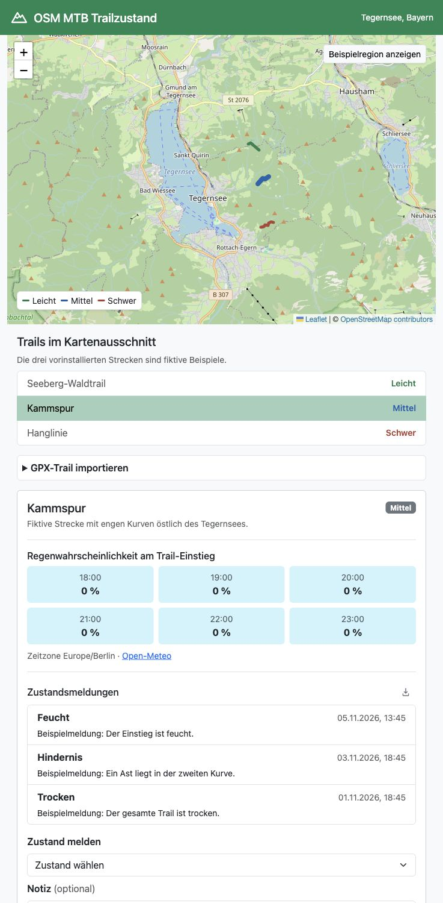

# OSM MTB Trailzustand



**[Live-Demo öffnen](https://mtbtrailzustand.dpdns.org/)**

Interaktive MTB-Karte für den Tegernsee mit drei fiktiven Beispieltrails. Es können die stündliche Regenwahrscheinlichkeit am Trail-Einstieg abgerufen und Zustände mit optionaler Notiz gemeldet werden. Ebenfalls ist ein GPX-Import von Trails möglich. Der GPX-Import befindet sich ganz unten in der Seitenleiste.

## Java-Technologien

- **JAX-RS (Jakarta REST)** stellt Trails als GeoJSON bereit, verarbeitet GPX-Importe und verwaltet Zustandsmeldungen über die REST-API.
- **MicroProfile** ruft mit dem Rest Client Wetterdaten von Open-Meteo ab. MicroProfile Config liefert die URL des Wetterdienstes, die Zeitlimits und den Datenbankpfad.
- **Jakarta Servlet** liefert über das Downloadsymbol rechts neben „Zustandsmeldungen“ die bis zu 20 neuesten Meldungen des ausgewählten Trails als CSV.

## Starten

Für den Build wird das JDK 17 benötigt.

### In Apache NetBeans

1. Klone das Repository oder entpacke das ZIP-Archiv.
2. Wähle unter Windows, macOS oder Linux **File → Open Project** und öffne den Ordner mit der [`pom.xml`](pom.xml). NetBeans erkennt ihn als Maven-Projekt.
3. Verwende JDK 17 für das Projekt und wähle **Run → Run Project**. Die mitgelieferte [`nbactions.xml`](nbactions.xml) startet Open Liberty über das Maven-Ziel `liberty:dev`. Du kannst das in NetBeans enthaltene Maven verwenden.
4. Öffne [http://localhost:9080](http://localhost:9080). Beende den Server über **Stop** im Ausgabefenster von NetBeans.

### Im Terminal

Führe mit installiertem Maven im Projektordner aus:

```sh
mvn liberty:dev
```

Öffne [http://localhost:9080](http://localhost:9080). Mit `q` beendest du den Open-Liberty-Entwicklungsserver.

## Docker und Deployment

```sh
docker build -t trailzustand:local .
docker run --rm -p 127.0.0.1:9080:9080 \
  --tmpfs /data:uid=1001,gid=0,mode=0750 \
  -e OSM_MTB_TRAILZUSTAND_DB_PATH=/data/trails trailzustand:local
```

Das Image enthält Open Liberty und die WAR-Datei. Beim Build läuft `mvn verify`.
Die lokale Vorschau speichert Daten im Container. Für den dauerhaften Betrieb
siehe [Deployment auf OCI mit Cloudflare Tunnel](deploy/README.md).

- [ ] **TODO für Projektadministratoren** – CI/CD mit GitHub Actions für das automatische Deployment auf den Demo-Server einrichten.

## Wartung

- **Datenbank sichern.** H2 speichert importierte Trails und Zustandsmeldungen in `trails.mv.db`. Der Standardpfad `data/trails` ist relativ zum Arbeitsverzeichnis des Liberty-Servers. Beende die App, bevor du die Datenbankdatei kopierst oder aus einer Sicherung wiederherstellst.
- **Daten außerhalb des Build-Ordners speichern.** Setze vor dem Start `export OSM_MTB_TRAILZUSTAND_DB_PATH="$PWD/data/trails"`, um die Datenbank im Projektordner zu speichern. Eine vorhandene Datenbank kannst du bei gestopptem Server an diesen Pfad kopieren.
- **Konfiguration ändern.** Port und Liberty-Features stehen in [server.xml](src/main/liberty/config/server.xml). Wetterdienst und Zeitlimits stehen in [microprofile-config.properties](src/main/resources/META-INF/microprofile-config.properties).
- **Build und Fehlersuche.** `mvn package` erstellt `target/osm-mtb-trailzustand.war`. Servermeldungen findest du in `target/liberty/wlp/usr/servers/defaultServer/logs/messages.log`.
- **Tests ausführen.** `mvn test` prüft GPX-Import, Datenbank, Wetterverarbeitung und CSV-Export. Die Tests verwenden temporäre Datenbanken und benötigen keinen laufenden Server.
- **Beispieltrails pflegen.** Die vorinstallierten Strecken stehen in [trails.geojson](src/main/resources/trails.geojson). Änderungen am Katalog erfordern einen Neustart oder eine erneute Bereitstellung.

### HTTP-Endpunkte

| Methode und Pfad | Funktion |
| --- | --- |
| `GET /api/trails?bbox=11.72,47.69,11.81,47.75` | Trails im Kartenausschnitt als GeoJSON |
| `POST /api/trails?difficulty=Mittel&name=Mein%20Trail` | GPX-Datei mit `Content-Type: application/gpx+xml` und einem Trailnamen importieren. |
| `GET /api/trails/{id}` | Einzelnen Trail als GeoJSON abrufen |
| `GET /api/trails/kammspur/forecast` | Regenvorhersage am Trail-Einstieg |
| `GET /api/trails/kammspur/reports` | Zustandsmeldungen abrufen |
| `POST /api/trails/kammspur/reports` | Zustand melden, zum Beispiel `{"condition":"muddy","note":"Matsch in der letzten Kurve."}` |
| `GET /exports/reports.csv?trail=kammspur` | Meldungen als CSV herunterladen |

## Lizenz

Der Quellcode steht unter der GNU General Public License, Version 3 (`GPL-3.0-only`). Der vollständige Lizenztext steht in [LICENSE](LICENSE).

Die Kartendaten stammen von © OpenStreetMap und stehen unter der Open Database License (ODbL). [OpenStreetMap-Lizenzhinweise](https://www.openstreetmap.org/copyright)
